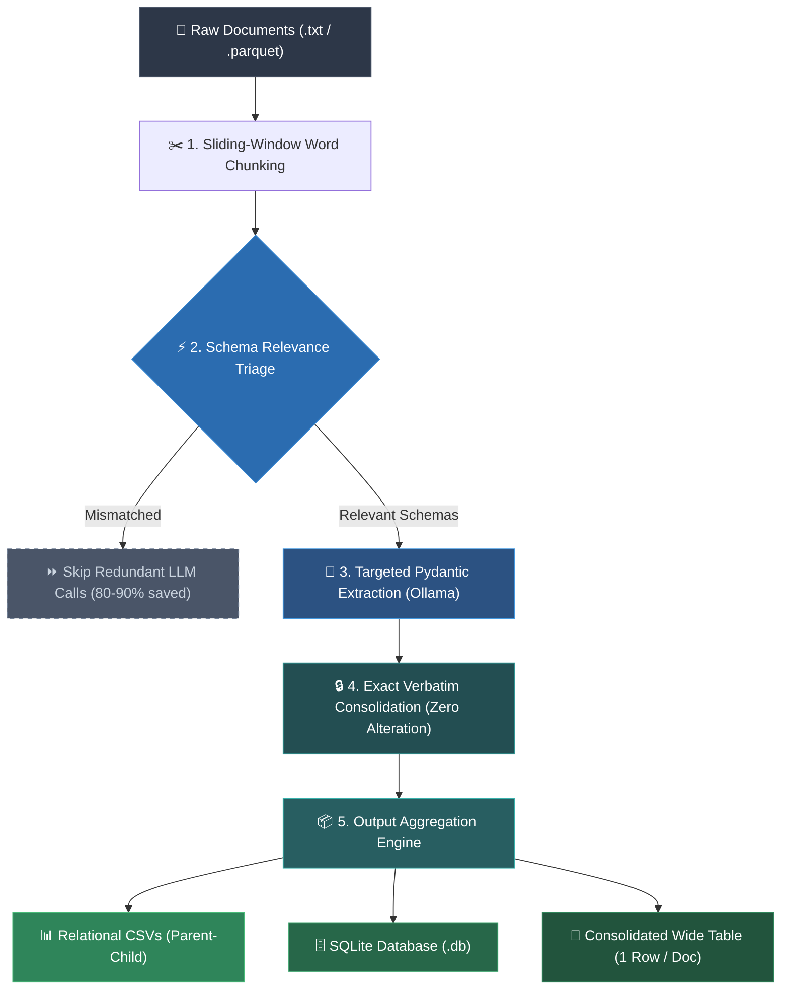

# SchemaMap

**SchemaMap** is a schema-driven framework for extracting structured data from unstructured text (clinical notes, reports, documents) using Pydantic models and local LLMs (via Ollama). It segments documents, pre-screens schemas, extracts validated entities, and aggregates results into relational CSV tables, SQLite databases, and consolidated wide tables.

---

## Workflow Diagram



---

## Key Features

- **Direct Single-Schema Extraction**: Extracts one clean Pydantic model at a time, avoiding hallucinations caused by oversized multi-schema prompts.
- **Fast Triage Pre-Screening**: Skips 80%–90% of irrelevant schemas per chunk for an 8x–10x speedup.
- **Verbatim Fidelity**: Strict null rules and exact preservation of raw strings, numbers, and ratings without mutation or averaging.
- **Consolidated Wide Table**: Generates a single table with 1 row per document, exploding 1-to-many child attributes, generating counts, and optionally embedding raw `source_text`.
- **Empty-Record Filtering**: Automatically drops empty extractions and prunes 0-row schema tables.
- **Granular Resume Tracking**: Recovers interrupted runs at the document, schema, and chunk levels without duplicate LLM queries.

---

## Installation

```bash
# 1. Clone repository
git clone https://github.com/childmindresearch/SchemaMap.git
cd SchemaMap

# 2. Set up virtual environment
python3 -m venv venv
source venv/bin/activate  # On Windows: venv\Scripts\activate

# 3. Install dependencies
pip install -r requirements.txt

# 4. Ensure Ollama is running with your target model
ollama pull qwen2.5:14b
```

---

## Configuration (`config.yaml`)

Core pipeline settings are managed in `config.yaml`:

```yaml
# Input data (.txt directory or .parquet file)
input:
  path: "inputs/sample_documents.parquet"
  format: "parquet"
  id_column: "id"
  text_column: "text"

# Schema directory or single .py file
schema:
  path: "schemas/test_schemas"
  class_name: null  # null auto-extracts all top-level root schemas

# LLM connection (Ollama / OpenAI-compatible endpoint)
model:
  name: "qwen2.5:14b"
  url: "http://localhost:11434/v1"
  num_async_calls: 4

# Text segmentation
chunking:
  size: 300
  overlap: 20

# Execution controls
execution:
  output_dir: "outputs/extracts"
  resume: true
  enable_triage: true

# Table aggregation & export
aggregation:
  output_dir: "outputs/aggregated_tables"
  db_file: "aggregated_data.db"
  csv: true
  sqlite: true
  multi_table: true
  drop_empty_records: true
  drop_empty_tables: true
  consolidated_wide_table: true
  wide_table_name: "consolidated_wide"
  include_source_text: true
```

---

## Usage

### 1. Run Complete Pipeline
```bash
python3 run_pipeline.py
```

### 2. Common CLI Overrides
```bash
# Custom schema directory and model
python3 run_pipeline.py --schema-path schemas/test_schemas --model-name qwen2.5:14b

# Test with Parquet dataset
python3 run_pipeline.py --input-dir inputs/sample_documents.parquet --input-format parquet

# Test with Text files directory
python3 run_pipeline.py --input-dir inputs/examples --input-format txt

# Toggle wide table and source text
python3 run_pipeline.py --wide-table --source-text

# Disable triage screening pass
python3 run_pipeline.py --no-triage
```

### 3. Run Pipeline Phases Separately
```bash
# Extract JSON only
python3 run_pipeline.py --skip-aggregation

# Aggregate existing JSON outputs only
python3 run_pipeline.py --skip-extraction
```

### 4. Run Unit Tests
```bash
python3 -m unittest discover tests
```

---

## Output Formats

Outputs are saved under `outputs/`:

| Directory / File | Description |
| :--- | :--- |
| `outputs/extracts/<doc_id>/` | Raw JSON extractions (`<doc_id>__<module>__<schema>.json`). |
| `outputs/prompt_payloads/` | Inspection text files containing exact prompts sent to the LLM. |
| `outputs/aggregated_tables/*.csv` | Normalized relational CSV tables with primary and foreign keys. |
| `outputs/aggregated_tables/aggregated_data.db` | Complete SQLite database with typed columns. |
| `outputs/aggregated_tables/consolidated_wide.csv` | Denormalized table (1 row/doc) with all fields, counts, and optional `source_text`. |

---

## License

MIT License. See `LICENSE` for details.
